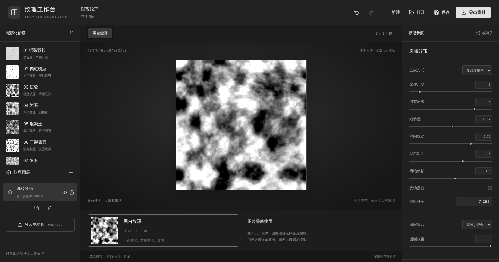
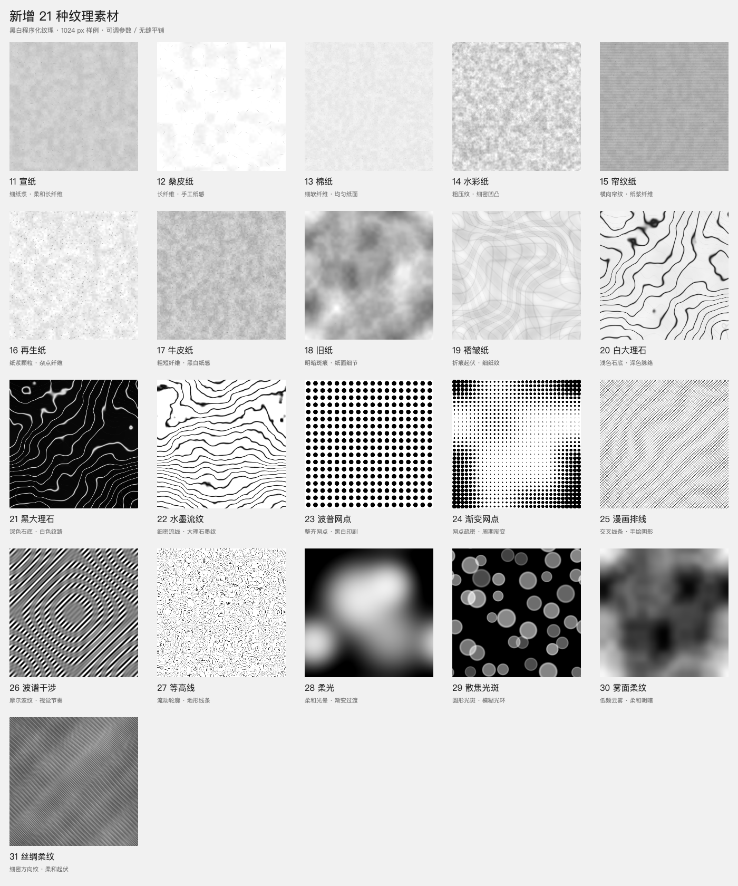

# Texture Generator


A local texture studio for designers. Generate seamless monochrome paper grain, speckles, grunge, fibers and cracks for Multiply overlays, transparent compositing and grayscale masks. Normal maps are optional. The main workspace shows the texture directly in 2D.

[Product plan](docs/product-plan.md) · [Capability coverage](docs/texture-coverage.md) · [Roadmap](docs/roadmap.md) · [Development](docs/development.md) · [Changelog](CHANGELOG.md) · [Published installers](https://github.com/FishXIN/Texture_Generator/releases)

**Version 0.7.0 combines editable custom artwork and the monochrome workbench. Download the matching installer from Releases.**



## Custom artwork

Upload your own PNG / SVG elements, generate a pattern, then switch to Manual to edit individual objects. Original colors and Alpha are preserved. Choose seamless tiling or canvas-only placement with element spacing and edge margins. Spacing −1 permits overlaps; 0 or higher uses conservative bounds to avoid overlaps. Constraints apply to static automatic placement; manual edits and motion can leave those bounds.

Export **Editable SVG** to keep SVG shapes and independent raster image objects. In compositions, continuous textures remain separate image layers; texture-only compositions remain one image when they cannot be represented as vectors. **Pure / optimized SVG** retains colored SVG artwork and rejects raster or incompatible effects. **Effects SVG** flattens the full appearance into one PNG. Editable exports are capped at 64 MB. Source removal cleans references and supports undo; locked references must be unlocked first.

## Monochrome textures

- One flat workspace combines monochrome textures, uploaded backgrounds and colored PNG/SVG elements in the same layer stack. Applying presets preserves uploaded artwork.
- Common adjustments appear first. Algorithms and seeds stay in advanced settings; normal maps are directly selectable in the export dialog.
- Switch between grayscale artwork and normal-map previews above the canvas. Both update live and support tiling; preview selection preserves export settings.
- Borderless controls, faint dividers and consistent neutral popups throughout both workspaces.
- Canvas shortcuts include square, 16:9, 9:16, 4:3 and other common ratios, with 1K / 2K / 4K / 8K quality choices and custom dimensions.
- Damped sliders update the canvas while dragging; a persistent worker renders the latest parameters and restores full preview detail on release.
- Background upload preserves the original aspect ratio. Export the whole canvas or just the materials, excluding the background image; colored compositions use 8-bit RGBA.
- 119 editable presets across 11 searchable visual groups: grain, fragments, film, paper, nature, painting, surfaces, digital, halftone, graphics and soft light.
- Unified particles, editable paths, radial/mirror/kaleidoscope layouts, manual dragging, SVG stamps and weighted source mixing.
- Independent particle density, size, grayscale and alpha ranges; safe original inputs retain separate grayscale and Alpha.
- Thirteen looping motions, including RK4 curl flow, vortex, wave, flicker, evolution and discrete snow refresh.
- Ten advanced algorithms: Value, Perlin, torus Simplex, Worley, uniform, Gaussian, salt-and-pepper, Poisson counts, blue noise and random Gabor kernels.
- Xuan, mulberry, cotton, watercolor, laid, recycled, kraft, aged and crumpled paper; white/black marble and ink marbling.
- Halftone dots, variable dots, comic hatching, spectral interference and contours; glow, bokeh, mist and satin patterns.
- Periodic noise, ridged noise, cellular patterns and smooth seeded dots with shared height/gradient calculations.
- Layer visibility, locks, duplication, ordering, blending, contrast, brightness, inversion and domain warp, with dedicated fiber density, vein width, dot coverage, edge softness and light-radius controls.
- Unit and 3 × 3 tiled preview; checkerboard, light and dark backgrounds for transparent output.
- Local PNG / JPEG / WebP / SVG grayscale sources, original-source retention and optional periodic edge blending.
- Project save/reopen, undo/redo and local recovery.
- Worker rendering with progress, cancellation and retry; identical seeds and UV positions retain their composition at different resolutions.

| Output | Usage |
| --- | --- |
| Grayscale PNG, 8 / 16 bit | Multiply overlay in a design app, grayscale mask or non-color height data |
| Black transparent PNG, 8 / 16 bit | Black pigment with alpha = 1 − grayscale; ordinary compositing |
| White transparent PNG, 8 / 16 bit | White pigment with alpha = grayscale; light overlays |
| Optional normal PNG, RGB 8 bit | Tangent-space directions, OpenGL +Y or DirectX −Y; import as non-color data |
| Paired ZIP | Texture, normal and an output manifest |
| Editable SVG | SVG shapes and independent raster objects; continuous textures remain images |
| Pure / optimized SVG | Colored artwork, graphic paths and reusable structures; incompatible effects are rejected |
| Effects SVG | Explicitly embeds PNG to retain continuous effects |
| PNG sequence ZIP | Arbitrary-frame loops, optional Alpha / normals, timing manifest |

The default is an 8-bit grayscale PNG. Select grayscale/transparent output, a normal map or both directly in the export dialog; normal strength and OpenGL/DirectX settings remain under advanced settings. Export longest edges are 128–8192 px and preserve the canvas ratio; preview is 512 px. True 16-bit samples are encoded directly from floating-point values, without an 8-bit Canvas intermediate. PNG compression streams small row blocks to reduce 8K memory use. Soft-light presets also support Screen/Soft Light blending or white transparent overlays. Preview backgrounds and tile guides are excluded. Older projects receive defaults for the new controls.



Paper and stone presets are procedural style simulations, not physical scans.

Limits: sixteen layers and imported sources, 2000 ordinary particles per layer, 512 blue/spaced samples, 5 MB per source and 25 MB per project. Preview sources decode at up to 1024 px; exports decode original raster detail and render SVG at the requested resolution. Procedural image inputs still use separate gray/Alpha channels. Sequence exports are limited to 128 million total pixels. Static preview is 512 px; dragging and animation use 192 px.

No colored material channels, 3D viewport, node editor or model baking is included. See [implementation and boundaries](docs/material-studio.md).

## Graphic and motion workspace

Open “打开旧版项目” in the project menu or `?studio=pattern` for the existing 0.2.0 workflow. Opening an older `.texture.json` routes to this workspace.

- Circles, ellipses, short lines and fragments with independent density, size, color and opacity.
- Multiple layers with visibility, locking, duplication, ordering and blend modes.
- Safe SVG import, manual placement and dragging, transforms, recoloring, weighted automatic scattering.
- Random, grid, staggered and clustered layouts; spacing, directional gradients and jitter.
- Separate seeded random streams and parameter locks; regeneration preserves manual objects.
- Periodic edge copies and neighbor-aware spacing, unit editing and 3 × 3 tiled preview.
- Rectangle, ellipse and SVG alpha masks, including exclusion regions.
- Drift, wandering, directional flow, rotation and breathing loops; playback and time scrubbing.
- Project files, embedded original assets, undo / redo, local recovery and parameter presets.
- Checkerboard, light, dark and custom preview backgrounds; tile boundaries and zoom.

Import, rendering and export run locally. The original raster/base-image workflow remains accessible through the top-bar **底图阵列** button.

## Exports

| Format | Output |
| --- | --- |
| PNG | Current frame, optional full Alpha transparency |
| JPEG | Current frame with the chosen canvas background |
| Pure SVG | Editable vector structure; rejects raster images, fonts and filters |
| Effects SVG | Sanitized SVG effects, with explicit compatibility notices |
| Optimized SVG | Reuses custom vector structures through definitions and references |
| PNG sequence ZIP | Transparent looping frames plus a timing and import manifest |

Choose the canvas, a selection, a seamless unit or a filled pattern. Export checks report size, object count, transparency and loop state. Generation supports progress, cancellation and retry.

SVG source files are retained. Scripts and external references are removed; unsupported elements and complex styles are reported. Text should be outlined before import. Blend modes, fonts and filters still require verification in the target design software.

Seamless drift uses eight snapped directions and integer tile journeys; duration and cycle count control speed without reseeding the layout. Spacing is conservative and constraints can reduce the resulting count. Continuous monochrome noise and editable paths are available in the main workspace. This older workspace does not have path layouts. Transparent video, PDF and animated SVG remain future work.

Limits: 64–4096 px canvas, 16 layers, 32 SVG assets, 20,000 generated particles and 2,000 manual objects. SVG inputs are limited to 5 MB each and projects to 25 MB. Static raster export supports up to 16 MP / 8192 px; sequences support 4 MP per frame, 720 frames and a 256 MB ZIP. Large or complex SVGs can still be expensive to render.

## Run locally

Use Node.js 20 / 22 and npm 10+.

```bash
git clone https://github.com/FishXIN/Texture_Generator.git
cd Texture_Generator
npm ci
npm run dev:web
```

```bash
npm run dev                       # Electron studio
npm run typecheck
npm run build
npx playwright install chromium
npm test
npm run dist:mac                  # On Windows: npm run dist:win
```

Playwright scenarios cover preset reproducibility, algorithm statistics/gradients, blue-noise spectral suppression, periodic time/UV, input Alpha, SVG pixel agreement, true 16-bit PNG, manual dragging, undo and the existing workflow.

Project architecture: `src/app` routes the workspaces; `features/material` owns monochrome fields, Worker generation, PNG encoding and the 2D editor; `project`, `assets`, `texture` and `export` retain the graphics/motion workflow. See [architecture](docs/architecture.md) and [contributing](CONTRIBUTING.md).

## License

[MIT](LICENSE)
