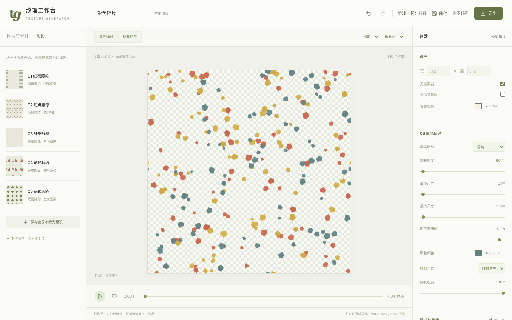

# Texture Generator

A local-first texture studio for designers. Generate graphic particles, arrange imported SVGs, create seamless patterns and looping motion, then export transparent images, editable vectors or PNG sequences.

[中文](README.md) · [Roadmap](docs/roadmap.md) · [Development](docs/development.md) · [Changelog](CHANGELOG.md) · [Published installers](https://github.com/FishXIN/Texture_Generator/releases)

**Main contains the 0.2.0 source. Existing release installers retain their older capabilities; check the attached version.**



## Features

- Circles, ellipses, short lines and fragments with independent density, size, color and opacity.
- Multiple layers with visibility, locking, duplication, ordering and blend modes.
- Safe SVG import, manual placement and dragging, transforms, recoloring, weighted automatic scattering.
- Random, grid, staggered and clustered layouts; spacing, directional gradients and jitter.
- Separate seeded random streams and parameter locks; regeneration preserves manual objects.
- Periodic edge copies and neighbor-aware spacing, unit editing and 3 × 3 tiled preview.
- Rectangle, ellipse and SVG alpha masks, including exclusion regions.
- Drift, wandering, directional flow, rotation and breathing loops; playback and time scrubbing.
- Project files, embedded original assets, undo / redo, local recovery and parameter presets.
- Checkerboard, light, dark and custom preview backgrounds; tile boundaries and zoom.

Import, rendering and export run locally. The original raster/base-image workflow remains accessible through the top-bar **底图阵列** button.

## Exports

| Format | Output |
| --- | --- |
| PNG | Current frame, optional full Alpha transparency |
| JPEG | Current frame with the chosen canvas background |
| Pure SVG | Editable vector structure; rejects raster images, fonts and filters |
| Effects SVG | Sanitized SVG effects, with explicit compatibility notices |
| Optimized SVG | Reuses custom vector structures through definitions and references |
| PNG sequence ZIP | Transparent looping frames plus a timing and import manifest |

Choose the canvas, a selection, a seamless unit or a filled pattern. Export checks report size, object count, transparency and loop state. Generation supports progress, cancellation and retry.

SVG source files are retained. Scripts and external references are removed; unsupported elements and complex styles are reported. Text should be outlined before import. Blend modes, fonts and filters still require verification in the target design software.

Seamless drift uses eight snapped directions and integer tile journeys; duration and cycle count control speed without reseeding the layout. Spacing is conservative and constraints can reduce the resulting count. Continuous noise, path layouts, transparent video, PDF and animated SVG are future work.

Limits: 64–4096 px canvas, 16 layers, 32 SVG assets, 20,000 generated particles and 2,000 manual objects. SVG inputs are limited to 5 MB each and projects to 25 MB. Static raster export supports up to 16 MP / 8192 px; sequences support 4 MP per frame, 720 frames and a 256 MB ZIP. Large or complex SVGs can still be expensive to render.

## Run locally

Use Node.js 20 / 22 and npm 10+.

```bash
git clone https://github.com/FishXIN/Texture_Generator.git
cd Texture_Generator
npm ci
npm run dev:web
```

```bash
npm run dev                       # Electron studio
npm run typecheck
npm run build
npx playwright install chromium
npm test
npm run dist:mac                  # On Windows: npm run dist:win
```

Playwright checks cover reproducibility, periodic spacing, loop boundaries, SVG sanitization, alpha masks, Canvas/SVG pixel comparisons, sequence archives, cancellation recovery and project save/reopen.

Project architecture: `src/app` assembles the studio; `features/project` owns serializable state and history; `assets` sanitizes and decodes SVGs; `texture` generates and renders scenes; `export` handles formats, checks and ZIP creation. See [architecture](docs/architecture.md) and [contributing](CONTRIBUTING.md).

[MIT](LICENSE)
