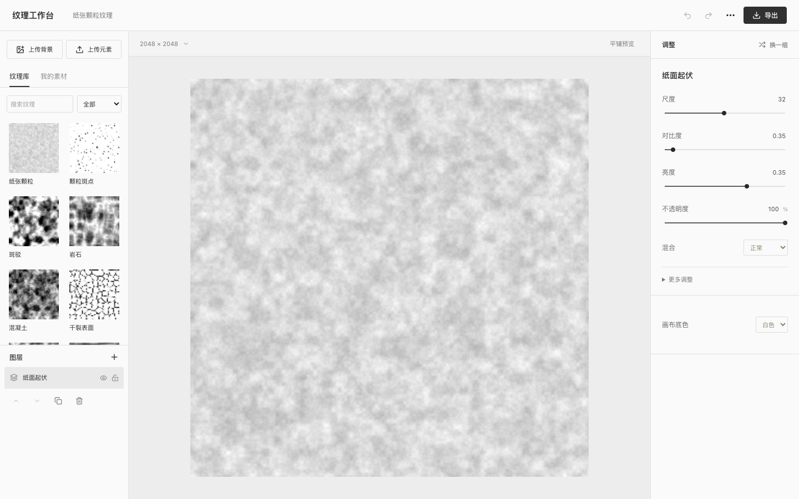
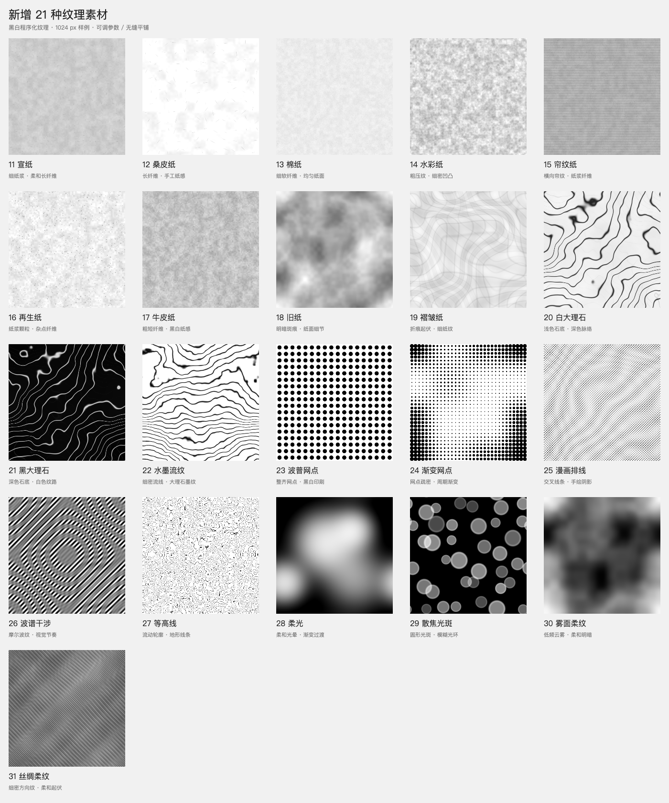

# Texture Generator

[English](#english) · [简体中文](#简体中文)

## English

A local texture studio for designers. Generate seamless monochrome paper grain, speckles, grunge, fibers and cracks for Multiply overlays, transparent compositing and grayscale masks. Normal maps are optional. The main workspace shows the texture directly in 2D.

[Product plan](docs/product-plan.md) · [Capability coverage](docs/texture-coverage.md) · [Roadmap](docs/roadmap.md) · [Development](docs/development.md) · [Changelog](CHANGELOG.md) · [Published installers](https://github.com/FishXIN/Texture_Generator/releases)

**Main contains the 0.6.0 source. Existing release installers retain their older capabilities; check the attached version.**



### Monochrome textures

- One flat workspace combines monochrome textures, uploaded backgrounds and colored PNG/SVG elements in the same layer stack. Applying presets preserves uploaded artwork.
- Common adjustments appear first. Algorithms, seeds and optional normal output are tucked into advanced settings.
- Damped sliders update the canvas while dragging; a persistent worker renders the latest parameters and restores full preview detail on release.
- Background upload preserves the original aspect ratio. Export the whole canvas or just the materials, excluding the background image; colored compositions use 8-bit RGBA.
- 119 editable presets across 11 searchable visual groups: grain, fragments, film, paper, nature, painting, surfaces, digital, halftone, graphics and soft light.
- Unified particles, editable paths, radial/mirror/kaleidoscope layouts, manual dragging, SVG stamps and weighted source mixing.
- Independent particle density, size, grayscale and alpha ranges; safe original inputs retain separate grayscale and Alpha.
- Thirteen looping motions, including RK4 curl flow, vortex, wave, flicker, evolution and discrete snow refresh.
- Ten advanced algorithms: Value, Perlin, torus Simplex, Worley, uniform, Gaussian, salt-and-pepper, Poisson counts, blue noise and random Gabor kernels.
- Xuan, mulberry, cotton, watercolor, laid, recycled, kraft, aged and crumpled paper; white/black marble and ink marbling.
- Halftone dots, variable dots, comic hatching, spectral interference and contours; glow, bokeh, mist and satin patterns.
- Periodic noise, ridged noise, cellular patterns and smooth seeded dots with shared height/gradient calculations.
- Layer visibility, locks, duplication, ordering, blending, contrast, brightness, inversion and domain warp, with dedicated fiber density, vein width, dot coverage, edge softness and light-radius controls.
- Unit and 3 × 3 tiled preview; checkerboard, light and dark backgrounds for transparent output.
- Local PNG / JPEG / WebP / SVG grayscale sources, original-source retention and optional periodic edge blending.
- Project save/reopen, undo/redo and local recovery.
- Worker rendering with progress, cancellation and retry; identical seeds and UV positions retain their composition at different resolutions.

| Output | Usage |
| --- | --- |
| Grayscale PNG, 8 / 16 bit | Multiply overlay in a design app, grayscale mask or non-color height data |
| Black transparent PNG, 8 / 16 bit | Black pigment with alpha = 1 − grayscale; ordinary compositing |
| White transparent PNG, 8 / 16 bit | White pigment with alpha = grayscale; light overlays |
| Optional normal PNG, RGB 8 bit | Tangent-space directions, OpenGL +Y or DirectX −Y; import as non-color data |
| Paired ZIP | Texture, normal and an output manifest |
| Pure / optimized SVG | Actual graphic paths and reusable structures; incompatible effects are rejected |
| Effects SVG | Explicitly embeds PNG to retain continuous effects |
| PNG sequence ZIP | Arbitrary-frame loops, optional Alpha / normals, timing manifest |

The default is an 8-bit grayscale PNG with normal output disabled. Export sizes are 128–4096 px; preview is 512 px. True 16-bit samples are encoded directly from floating-point values, without an 8-bit Canvas intermediate. Soft-light presets also support Screen/Soft Light blending or white transparent overlays. Preview backgrounds and tile guides are excluded. Older projects receive defaults for the new controls.



Paper and stone presets are procedural style simulations, not physical scans.

Limits: sixteen layers and imported sources, 2000 ordinary particles per layer, 512 blue/spaced samples, 5 MB per source and 25 MB per project. Preview sources decode at up to 1024 px; exports decode original raster detail and render SVG at the requested resolution. Procedural image inputs still use separate gray/Alpha channels. Sequence exports are limited to 128 million total pixels. Static preview is 512 px; dragging and animation use 192 px.

No colored material channels, 3D viewport, node editor or model baking is included. See [implementation and boundaries](docs/material-studio.md).

### Graphic and motion workspace

Open “打开旧版项目” in the project menu or `?studio=pattern` for the existing 0.2.0 workflow. Opening an older `.texture.json` routes to this workspace.

- Circles, ellipses, short lines and fragments with independent density, size, color and opacity.
- Multiple layers with visibility, locking, duplication, ordering and blend modes.
- Safe SVG import, manual placement and dragging, transforms, recoloring, weighted automatic scattering.
- Random, grid, staggered and clustered layouts; spacing, directional gradients and jitter.
- Separate seeded random streams and parameter locks; regeneration preserves manual objects.
- Periodic edge copies and neighbor-aware spacing, unit editing and 3 × 3 tiled preview.
- Rectangle, ellipse and SVG alpha masks, including exclusion regions.
- Drift, wandering, directional flow, rotation and breathing loops; playback and time scrubbing.
- Project files, embedded original assets, undo / redo, local recovery and parameter presets.
- Checkerboard, light, dark and custom preview backgrounds; tile boundaries and zoom.

Import, rendering and export run locally. The original raster/base-image workflow remains accessible through the top-bar **底图阵列** button.

### Exports

| Format | Output |
| --- | --- |
| PNG | Current frame, optional full Alpha transparency |
| JPEG | Current frame with the chosen canvas background |
| Pure SVG | Editable vector structure; rejects raster images, fonts and filters |
| Effects SVG | Sanitized SVG effects, with explicit compatibility notices |
| Optimized SVG | Reuses custom vector structures through definitions and references |
| PNG sequence ZIP | Transparent looping frames plus a timing and import manifest |

Choose the canvas, a selection, a seamless unit or a filled pattern. Export checks report size, object count, transparency and loop state. Generation supports progress, cancellation and retry.

SVG source files are retained. Scripts and external references are removed; unsupported elements and complex styles are reported. Text should be outlined before import. Blend modes, fonts and filters still require verification in the target design software.

Seamless drift uses eight snapped directions and integer tile journeys; duration and cycle count control speed without reseeding the layout. Spacing is conservative and constraints can reduce the resulting count. Continuous monochrome noise and editable paths are available in the main workspace. This older workspace does not have path layouts. Transparent video, PDF and animated SVG remain future work.

Limits: 64–4096 px canvas, 16 layers, 32 SVG assets, 20,000 generated particles and 2,000 manual objects. SVG inputs are limited to 5 MB each and projects to 25 MB. Static raster export supports up to 16 MP / 8192 px; sequences support 4 MP per frame, 720 frames and a 256 MB ZIP. Large or complex SVGs can still be expensive to render.

### Run locally

Use Node.js 20 / 22 and npm 10+.

```bash
git clone https://github.com/FishXIN/Texture_Generator.git
cd Texture_Generator
npm ci
npm run dev:web
```

```bash
npm run dev                       # Electron studio
npm run typecheck
npm run build
npx playwright install chromium
npm test
npm run dist:mac                  # On Windows: npm run dist:win
```

Playwright scenarios cover preset reproducibility, algorithm statistics/gradients, blue-noise spectral suppression, periodic time/UV, input Alpha, SVG pixel agreement, true 16-bit PNG, manual dragging, undo and the existing workflow.

Project architecture: `src/app` routes the workspaces; `features/material` owns monochrome fields, Worker generation, PNG encoding and the 2D editor; `project`, `assets`, `texture` and `export` retain the graphics/motion workflow. See [architecture](docs/architecture.md) and [contributing](CONTRIBUTING.md).

### License

[MIT](LICENSE)

---

## 简体中文

面向设计师的本地黑白纹理制作工具：制作纸张颗粒、斑驳、纤维、裂纹等无缝素材，用于平面设计正片叠底、透明叠加或灰度蒙版，也可按需导出法线。直接预览二维素材，不需要 3D 场景。

[English](#english) · [产品策划](docs/product-plan.md) · [能力对照](docs/texture-coverage.md) · [迭代路线](docs/roadmap.md) · [开发指南](docs/development.md) · [变更记录](CHANGELOG.md) · [已发布安装包](https://github.com/FishXIN/Texture_Generator/releases)

> 主分支为 **0.6.0** 工作台源码。GitHub Releases 中的旧版安装包仍是旧功能，以附件版本为准。


### 黑白纹理工作台

纹理和上传素材共用一个画布、同一组图层。直接上传背景与 PNG / SVG 元素，保留原图颜色和透明度；选择纹理预设不会清空素材。背景上传自动沿用原图比例，可导出完整画布，或仅导出不含背景图的素材。

界面采用浅灰扁平布局，默认展示常用调整；算法、种子、运动细节与法线收进高级设置。滑块带轻阻尼，拖动时中心效果持续更新，松开后恢复清晰预览，一次撤销还原整次拖动。

默认打开黑白素材画布。内置 **119 个可编辑预设、11 个视觉分类**。颗粒、点与碎片、胶片、纸张、自然连续、绘画印刷、表面、数字故障、网点 / 波谱、图形、柔光分别筛选，算法放在高级面板。

图形、连续纹理和动态使用同一项目：12 种排列、路径节点 / SVG 轮廓读取、镜像、万花筒、手工拖动；独立尺寸 / 明暗 / 透明度；输入灰度和 Alpha 驱动半调、复印、印章与磨损。13 种循环运动覆盖流场、波浪、涡旋、呼吸、闪烁、消散、形变、视差、雪花刷新与演化。10 种基础算法均有实际实现。[逐项能力与边界](docs/texture-coverage.md)。

| 分类 | 纹理 |
| --- | --- |
| 基础颗粒 | 细密、粗粒、混合、稀疏、高密、单色、明暗、半透明、柔边、硬边、团簇 |
| 点与碎片 | 圆点、椭圆、不规则斑点、方块、多边形、短线、星点、空心圆环、碎屑、飞溅 |
| 胶片 | 黑白胶片、高感粗粒、暗部噪点、灰尘、划痕、老照片、复印墨粉 |
| 纸张 | 宣纸、桑皮纸、棉纸、水彩纸、帘纹纸、再生纸、牛皮纸、旧纸、褶皱纸，以及纸张颗粒和方向纤维 |
| 自然连续 | 云雾、烟气、团块、湍流、木纹、地形、水波、火焰 |
| 绘画印刷 | 喷漆、喷枪、墨水渗化、干刷、铅笔、炭笔、粉笔、蜡笔、丝网、印章、油墨磨损 |
| 材质表面 | 白 / 黑大理石、水墨流纹、沙粒、岩石、混凝土、石膏、灰泥、锈蚀、磨砂、拉丝、刮擦、剥落、裂纹、编织 |
| 数字故障 | 黑白雪花、像素颗粒 / 块面、扫描线、条带、故障切片、压缩失真、信号干扰 |
| 网点 / 波谱 | 圆 / 方 / 椭圆 / 线网点、随机 / 有序抖动、均匀 / 间距 / 聚集散点、渐变 / 放射 / 路径点阵、漫画排线、波谱干涉、等高线 |
| 图形 | 单图形、多图形、随机尺寸 / 旋转、错位、镜像、万花筒、彩纸形状、花草、符号、有机轮廓、手工编排 |
| 柔光 | 柔光光晕、散焦光斑、雾面柔纹、丝绸柔纹 |


这些效果是可重复编辑的程序化模拟，适合设计素材制作；纸张和石材不标为实物扫描。

| 能力 | 0.6.0 |
| --- | --- |
| 连续纹理 | 周期多尺度噪声、脊线、细胞 / 裂纹、方向纹路与平滑随机斑点 |
| 精细控制 | 按纹理显示纤维密度、柔和度、脉络宽度、网点覆盖、光斑范围等参数；密度与权重独立 |
| 多图层 | 显隐、锁定、复制、排序、删除；混合、细节叠加、正片叠底、变亮 |
| 检查 | 单元与 3 × 3 平铺；透明素材在棋盘格 / 白底 / 黑底检查 |
| 上传素材 | 本地导入 PNG / JPEG / WebP / SVG 背景和元素；保留原色与 Alpha，也可在更多调整里上传蒙版 |
| 项目 | `.material.json` 保存、打开、撤销重做、本地恢复 |
| 可选法线 | 同一灰度场导出切线空间法线，OpenGL / DirectX 与独立强度 |
| 本地处理 | 预览与正式生成在 Worker 中执行，导出有进度、可取消并重试 |

**导出得到什么：**

| 出口 | 用法 |
| --- | --- |
| 上传素材合成 PNG · RGBA 8 位 | 保留原色与透明度，输出整面画布或仅素材 |
| 黑白 PNG · 8 / 16 位 | 真灰度；在平面设计软件中选择正片叠底，白色保留底图；也可作为灰度蒙版或高度 |
| 透明 PNG · 8 / 16 位 | 纯黑纹理＋Alpha，白色转透明；直接叠加到作品上 |
| 白色透明 PNG · 8 / 16 位 | 白色光晕＋Alpha，亮度作为透明度；用于柔光叠加 |
| 法线 PNG · RGB 8 位 | 按需启用，蓝紫色为方向编码；作为非颜色数据读取 |
| 纹理＋法线 ZIP | 两张配套 PNG 与尺寸、种子、位深、方向说明 |
| 纯 / 优化 SVG | 真实路径、图形与复用结构；软边、连续纹理和效果混合需换效果模式 |
| 效果 SVG | 明确嵌入 PNG，保留连续灰度 / Alpha |
| PNG 序列 ZIP | 任意相位循环采样，支持透明和可选法线，附时长 / 帧率说明 |

导出 128–4096 px，预览 512 px；16 位从浮点灰度直接编码，保留超过 256 级的细节。默认导出黑白 8 位 PNG，法线默认关闭。柔光类不透明图可使用滤色或柔光混合，透明白色版可直接增加光晕。透明衬底与预览边界不会写入文件。旧 0.3.0 项目可打开，新参数自动补全。

最多 16 层、16 个素材、每层 2000 个普通图形，蓝噪 / 最小间距最多 512 个；单个素材 5 MB，项目 25 MB。预览素材解码上限 1024 px；导出重新读取原图细节，SVG 按导出尺寸解码。纯纹理保留真 8 / 16 位灰度，上传素材合成为 8 位 RGBA。序列总像素上限 128 百万。静态预览 512 px，拖动和动态 192 px。上传背景并不自动融合边缘；纹理与元素保留周期平铺逻辑。

不包含彩色材质、3D 预览、节点编辑器或模型烘焙。用于高度 / 法线时请按 Non-Color 数据读取；目标软件的导入设置仍需核对。[实现与边界](docs/material-studio.md)。

### 图形与动态工作台

通过项目菜单中的「打开旧版项目」或 `?studio=pattern` 打开既有 0.2.0 工作流；旧 `.texture.json` 项目自动转到这个入口。

| 能力 | 0.2.0 |
| --- | --- |
| 图形纹理 | 圆点、椭圆、短线、碎片；密度、尺寸、颜色与透明度独立 |
| 图层 | 显隐、锁定、复制、排序、删除；正常、正片叠底、滤色、叠加、颜色加深 |
| SVG 编排 | 本地导入、自由摆放、拖动、复制、旋转、缩放、改色；多个素材按比例散布 |
| 自动排列 | 随机、网格、错位、聚集；间距、方向、疏密渐变与扰动 |
| 可复现 | 独立随机种子、参数锁定、局部随机；重新生成不打乱手工图形 |
| 空间无缝 | 周期边缘副本、相邻单元避让、单元编辑与 3 × 3 整面预览 |
| 蒙版 | 矩形、椭圆、SVG 透明轮廓；生成范围或避让区域 |
| 循环动态 | 漂移、游动、方向流动、旋转、呼吸；时间定位、对象运动锁定 |
| 项目 | 素材、图层、手工对象、种子、运动与导出配置保存；撤销重做、本地恢复 |
| 检查预览 | 棋盘格、深色、浅色、自定义底；单元边界和 25%–200% 缩放 |
| 原有功能 | 顶栏「底图阵列」保留旧版底图与位图元素编排 |

所有导入、渲染与导出均在本机处理，作品不上传服务器。内置预设可继续修改，也可以保存自己的参数预设。

#### 图形与动态导出

| 出口 | 结果与边界 |
| --- | --- |
| PNG | 当前帧；可保留完整 Alpha；预览衬底不会进入透明文件 |
| JPEG | 当前帧；使用画布背景颜色，不保留透明 |
| SVG · 纯矢量 | 真实图形结构；阻止含位图、字体或滤镜的素材 |
| SVG · 效果保留 | 保留清理后的 SVG 外观，可含内嵌位图、字体或滤镜，并列出兼容提醒 |
| SVG · 优化 | 复用自定义图形结构，减少重复内容；仍要求纯矢量素材 |
| PNG 序列 ZIP | 每帧保留 Alpha；包含帧率、尺寸、时长和循环说明 `manifest.json` |

导出区域包括当前画布、选区、无缝重复单元和铺满的成品图。面板显示实际尺寸、对象数、透明状态、循环状态和 SVG 大小；生成过程可以取消，失败后可以继续编辑。

**当前边界：**

- SVG 清理脚本、外部引用和不支持的元素，保留原始文件供下载。支持简单标签、类、ID 与后代 / 子代样式选择器；复杂样式会提示。文字建议在设计软件中转轮廓。
- 空间无缝漂移吸附到八个方向，按整数个单元循环；速度由时长与循环次数控制。运动参数不会重抽静态分布。
- 间距是保守的包围范围避让，蒙版按 Alpha 采样选择生成位置，再按轮廓裁切显示；限制可能降低实际数量。
- 本入口提供图形颗粒；连续黑白纹理和可编辑路径位于默认工作台。此旧入口没有路径排列；透明视频、PDF 与动态 SVG 尚未提供。
- SVG 混合与效果仍需在目标设计软件核对。浏览器像素检查通过不等于所有设计软件均已验证。

规模限制：画布 64–4096 px，16 图层、32 SVG 素材、20,000 自动颗粒、2,000 手工对象；单个 SVG 5 MB，项目 25 MB。静态位图最多 16 MP / 8192 px；序列每帧最多 4 MP、720 帧、ZIP 256 MB。复杂 SVG 或高密度作品仍可能较慢，编辑预览降采样不会改变种子与排列。详见[开发与验收](docs/development.md)。

#### 图形与动态制作流程

1. 选择预设或新建项目，设定画布与无缝模式。
2. 生成颗粒，或导入 SVG 后选择「放置」「散布」。
3. 调整图层、排列、透明度、蒙版；锁定满意的随机参数。
4. 在整面预览检查重复节奏，在深浅底检查透明效果。
5. 开启运动并播放，或定位到需要的静态帧。
6. 保存 `.texture.json` 项目，再选择用途导出。

### 本地运行

推荐 Node.js 20 / 22、npm 10+。

```bash
git clone https://github.com/FishXIN/Texture_Generator.git
cd Texture_Generator
npm ci
npm run dev:web    # 浏览器工作台，默认 http://127.0.0.1:5173
```

```bash
npm run dev        # Electron 桌面工作台
npm run typecheck
npm run build      # 前端 + Electron 生产构建
npx playwright install chromium
npm test           # 真实浏览器验收
npm run dist:mac   # macOS 安装包；Windows 使用 dist:win
```

安装包输出到 `release/`，不提交到源码仓库。浏览器验收覆盖预设复现、算法统计 / 梯度、蓝噪频谱、空间 / 时间循环、输入 Alpha、SVG 像素对照、16 位 PNG、手工拖动 / 撤销和旧工作台兼容。[环境与证书说明](docs/development.md)。

### 目录

```text
Texture_Generator/
├── electron/                  # 桌面窗口、预加载与原生文件保存
├── src/
│   ├── app/                   # 工作台组装、入口、全局样式
│   ├── features/
│   │   ├── material/          # 黑白纹理、可选法线、Worker、8/16 位 PNG 与二维工作台
│   │   ├── project/           # 作品模型、历史、保存、预设、图层与参数
│   │   ├── assets/            # SVG 清理与解码；旧版位图素材模块
│   │   ├── texture/           # 确定性场景、周期运动、Canvas；旧版阵列
│   │   └── export/            # 导出检查、SVG、位图与 PNG 序列 ZIP
│   └── shared/                # 公共 UI、工具与桌面桥接类型
├── tests/                     # Playwright 浏览器验收
├── docs/                      # 产品、架构、开发与发布说明
└── .github/                   # CI、发布与协作模板
```

模块职责见[架构说明](docs/architecture.md)。贡献前请阅读 [CONTRIBUTING](CONTRIBUTING.md)，问题与素材兼容反馈请提交到 [Issues](https://github.com/FishXIN/Texture_Generator/issues)。

### 许可

[MIT](LICENSE)
