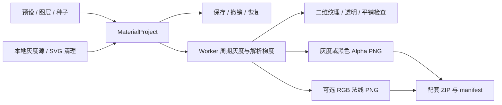
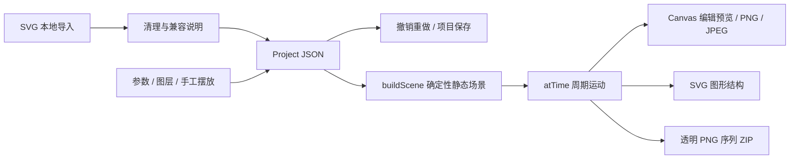

# 架构与目录约定

本文对应 0.5.0。默认入口在同一 `MaterialProject` 内实现黑白连续场、图形、输入灰度 / Alpha 和循环动态；历史图形工作台保留在 `?studio=pattern`，原有项目格式不变。

## 完整黑白纹理库

`model.ts` 保存统一参数和旧项目迁移，`presets.ts` 补充 88 个预设，合计 119 个。视觉分类、图形排列和算法分别选择。

| 文件 | 职责 |
| --- | --- |
| `algorithms.ts` | 周期 Value / Perlin / 4D torus Simplex / Worley；独立均匀、Gaussian、salt、Poisson；best-candidate Blue Noise；随机 Gabor 核 |
| `particles.ts` | 统一图形实例、轮廓、弧长路径、周期避让、镜像 / 扇区、手工对象、逐粒灰度 / Alpha、局部采样桶 |
| `effects.ts` | 胶片 / 纸浆 / 自然 / 笔触 / 表面 / 数字生成器；输入亮度、边缘与 Alpha 驱动 |
| `animation.ts` | 周期属性 / 位置、散度为零的旋度场和 RK4；连续层使用 48² 周期 bicubic 映射缓存 |
| `vector.ts` | 真实路径 / defs / use、源 SVG 清理与单色化；不兼容项阻止纯导出，效果模式嵌入 PNG |
| `sequence.ts` | 相位 `frame / frameCount` 的 PNG 编码和 ZIP，manifest 保存时长 / 帧率 / 通道 / 项目 |
| `MaterialLayerTools.tsx` | 分布、输入、手工图形、路径、算法和独立运动控制 |

每层可保存 `objects`、`sourceMix`、路径、算法和运动；项目保存 `timeline`。手工轮廓有独立种子，参数随机不改其形状。图层锁定控制编辑，对象 / 图层的运动锁定单独生效。

原图保持嵌入；解码保存 `pixels`（高度中灰合成）、`gray` 和 `alpha` 三个通道。SVG 按最长边 1024 px 解码，位图只降采样。DOM 清理 / 路径采样在主线程，Worker 只接收数值。

连续字段使用解析或局部差分梯度；离散白噪声的格点内部梯度为零。预览 / 导出共用 UV 和 phase。流场先计算周期 RK4 位移网格，再用 bicubic 插值和导数映射采样梯度；没有逐帧累积误差。图形按实例轨迹计算，漂移走整数单元，其他连续模式用周期三角函数。

静态 512 px 预览，播放时 192 px，渲染完成后再请求下一帧，避免无界堆积。参数改变会取消旧 Worker。序列最多 128 百万总像素。SVG 图形导出在主线程清理结构；位图 / 效果 / 序列在 Worker 内执行，可终止。

数学、文件和界面验证见 `tests/library.spec.ts`；逐项清单和模拟边界见 [能力对照](texture-coverage.md)。

## 模块职责

| 目录 | 职责 | 主要入口 |
| --- | --- | --- |
| `electron/` | 窗口、预加载桥接、系统保存 | `main.ts`、`preload.ts` |
| `src/app/` | 入口路由、旧工作台组装与全局样式 | `App.tsx`、`PatternStudio.tsx`、`styles.css` |
| `features/material/` | 周期黑白场、梯度、可选法线、Worker、导入、真 8/16 位 PNG 与二维界面 | `engine.ts`、`model.ts`、`worker.ts`、`png.ts`、`MaterialStudio.tsx` |
| `features/project/` | 可序列化作品、历史、参数预设、图层、素材列表、参数界面 | `model.ts`、`store.ts`、`io.ts`、`Library.tsx`、`Inspector.tsx` |
| `features/assets/svg.ts` | SVG 清理、源文件保留、样式内联、ID 隔离、改色与解码缓存 | `sanitizeSvg`、`assetSvg`、`assetImage` |
| `features/texture/engine/` | 确定性图形、周期避让、蒙版采样、运动与渲染 | `scene.ts`、`render.ts`、`rng.ts` |
| `features/texture/components/` | 编辑画布与原有底图阵列界面 | `StudioCanvas.tsx`、`LegacyEditor.tsx` |
| `features/export/` | 导出区域、检查、PNG/JPEG、三种 SVG、逐帧 ZIP | `studioExport.ts`、`studioSvg.ts`、`zip.ts` |
| `shared/` | 公共 UI、旧版工具与桌面类型 | `ui/StudioFields.tsx`、`types/` |
| `tests/` | 真实 Chromium 中的引擎性质、独立文件验证与 UI 验收 | `library.spec.ts`、`material.spec.ts`、`studio.spec.ts` |

同一功能的界面、类型和状态放在一起，不创建规划功能的空目录。跨模块使用 `@/`，模块内优先使用相对路径。

## 黑白纹理数据流

项目使用 `kind: surface-material` 与 `.material.json`，保存最多 20 步历史。8 个图层、4 个源；逐项验证类型、范围、唯一 ID 和引用。解码源最长边上限 1024 px，保留原始嵌入数据。SVG 在实际解码前重新清理；禁止远程位图 URL。

引擎按归一化 UV 采样。整数周期 value noise、quintic 插值、周期 feature points、整数方向波向量和周期 domain warp 保持四边连续。所有图层运算也变换解析梯度，因此法线对应最终灰度。预览和不同导出尺寸在同一 UV 得到相同值。

预览与正式导出使用独立 Worker；更新参数或取消终止对应 Worker，返回的旧任务不会覆盖新图。Worker 内完成 PNG 编码和 ZIP 打包。灰度 PNG 为 type 0；透明黑白为 type 4，黑色 gray=0、alpha=1−height，白色 gray=1、alpha=height；法线 type 2。16 位从浮点场大端写入，zlib 与 CRC32 遵循 PNG 格式，不经过 Canvas 降至 8 位。

`generatorControls` 统一定义生成器标签；119 个预设附分类元数据。旧项目缺少新参数时由解析器补全，不改变种子；coverage 缺失时按旧 detail 公式恢复。纸张纤维、光晕与 Gabor 核采用紧支撑保证周期边缘。

法线默认关闭。OpenGL / DirectX 仅绿色通道相反，强度不改变灰度。二维 Canvas 是 8 位预览；棋盘格等背景只由 CSS 提供。没有 WebGL 或 Three.js 依赖。细节和文件边界见 [material-studio.md](material-studio.md)。

## 图形与动态作品数据流

`Project` 保存画布、独立背景、图层、导入素材原文、手工对象、随机种子、运动和导出配置。DOM、图片解码缓存与预览状态不写入项目文件。重新打开时验证结构、范围与引用，并重新清理素材，不能直接信任文件中的 `pure` 或已清理 SVG 字段。

Zustand store 保存最多 40 步历史。连续参数输入在短时间内按分组合并；新作品与预设切换也可以撤销。浏览器恢复副本为尽力保存，空间不足时提示下载项目文件。

## 场景与运动约定

- 分布、尺寸、角度和颜色使用独立的 `mulberry32` 种子。自动图形与手工对象分别存储，随机操作只改变未锁定种子。
- 图形数量、尺寸与画布都有限制。自定义 SVG 以最长边匹配颗粒尺寸，防止长宽比造成意外巨幅图形。
- 间距使用网格桶与周期距离，按最大尺寸保守避让；尝试上限会使实际数量低于目标。网格 / 错位布局中的不合格单元不进行额外补点。
- 蒙版先以 256 × 256 Alpha 采样选择生成位置，渲染时再按蒙版轮廓裁切。细于采样网格的轮廓可能影响生成密度。
- `atTime` 只根据静态对象与时间计算运动，周期为 `[0, duration)`。平铺漂移按整数个单元运动，其余模式使用周期三角函数；锁定运动的手工对象保持原位。
- `copies` 派生区域内的周期副本；副本不增加逻辑对象数量。画布拖动修改原始对象，边缘副本随之同步。
- 整面 PNG 与无缝 SVG 按完整区域直接绘制，不先缩放已栅格化的单元再拼接，避免分数倍率带来的中间接缝。

## 渲染与导出

Canvas 和 SVG 共用场景、运动、图形路径与周期副本计算。预览分辨率最多 4 MP，不改变逻辑场景；导出按所选尺寸绘制。自定义 SVG 在位图出口中按需要解码到最高 4096 px 的最长边，纯 SVG 出口保留矢量。

图层先独立绘制，再应用蒙版、透明度和混合。背景层与预览衬底独立；导出是否带背景由导出面板决定。JPEG 总会绘制画布背景颜色。

SVG 用 DOMParser 清理后序列化，内部 ID 与引用按实例隔离。简单 CSS 规则按优先级、声明顺序与 `!important` 内联；复杂选择器、字体、滤镜与位图有明确说明。改色保留渐变引用和透明度。优化模式通过 `defs/use` 复用图形；纯矢量和优化模式均拒绝含位图、字体或滤镜的已用素材。

PNG 序列采样首帧到循环结束前一帧，不重复结束帧。时长乘帧率必须为整数；ZIP 采用 store 模式与 CRC32，包含 PNG 和 `manifest.json`。取消信号在每帧、编码前后与打包前检查；不会更换格式或修改当前分布。

桌面保存通过明确的 IPC 参数传输文件内容，浏览器使用 Blob 下载。序列暂在内存累积，超过 256 MB 会停止并提示调整；云端渲染不在本版范围内。

## 旧版阵列

`LegacyEditor` 沿用原 `assets/store.ts`、`texture/store.ts`、`generateLayout`、`renderScene` 与旧导出模块。旧 SVG 出口也进行清理与实例 ID 隔离；发现安全或效果兼容问题时，提示到工作台检查并使用相应出口。底图和位图素材的使用规则保持独立；新工作台的项目保存和循环序列不自动适用于该入口。

连续黑白纹理与可编辑路径已统一在材质引擎；旧图形入口没有路径排列。后续透明视频应扩展对应出口，不能绕过作品模型或静默降级。验收范围见 [development.md](development.md)。
